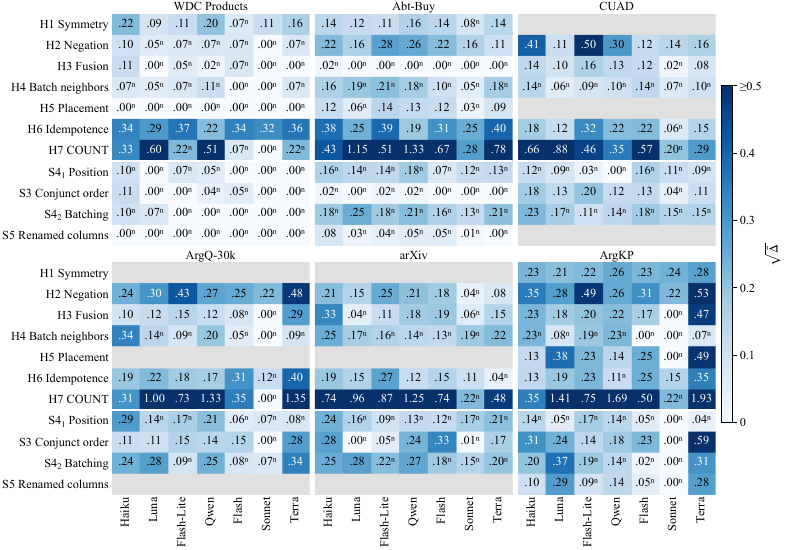
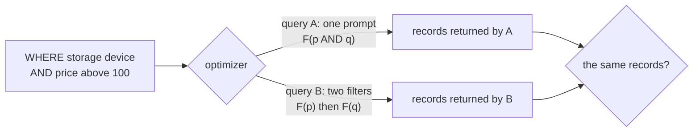
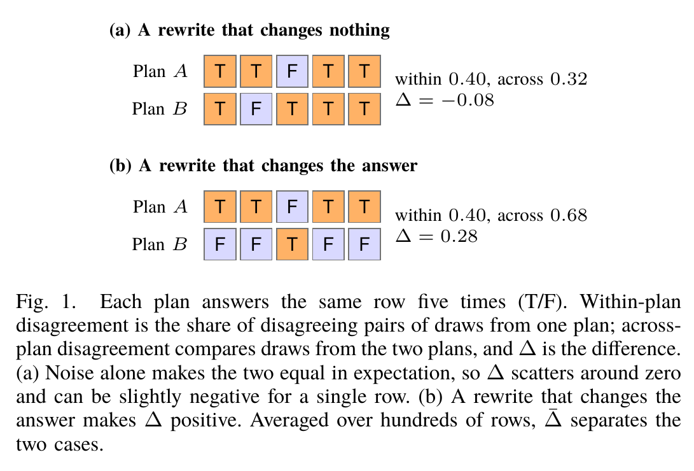
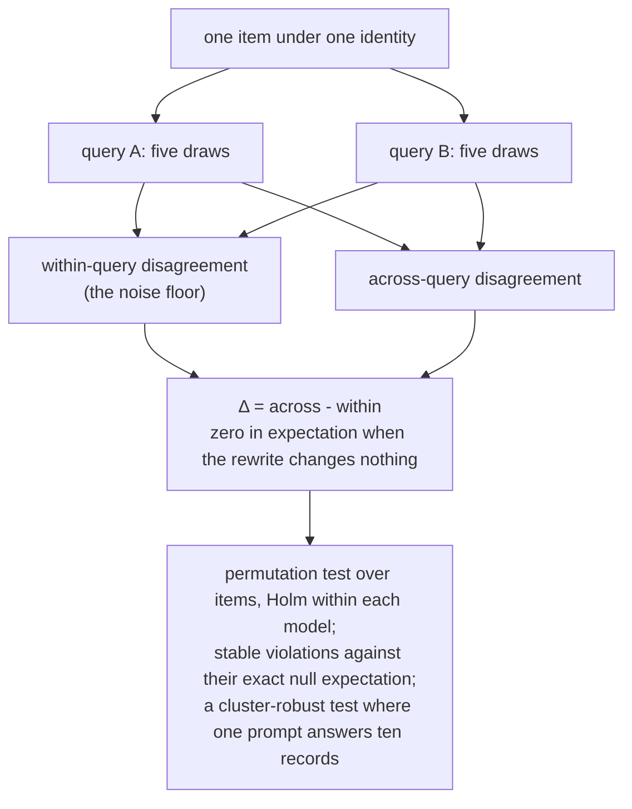
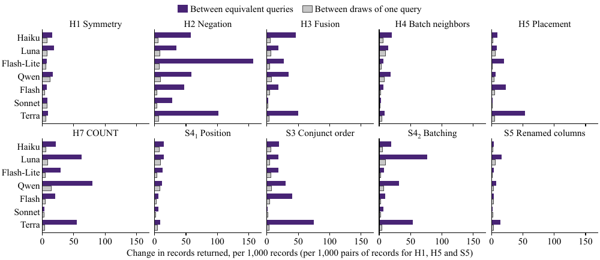
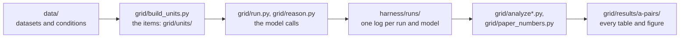

<h1 align="center">Do Semantic Operators Survive Query Rewriting?</h1>

<h3 align="center"><em>A Noise-Calibrated Audit of LLM-Powered Query Processing</em></h3>

<p align="center">Harsh Dubey and Shubham Vatsal · New York University<br>ICDE 2027 · Experiment, Analysis and Benchmark track</p>

<p align="center"><a href="docs/DESIGN.md">Design</a> · <a href="docs/DATA.md">Data</a> · <a href="grid/results/a-pairs">Results</a> · <a href="#reproduce">Reproduce</a> · <a href="CITATION.cff">Cite</a></p>

Query engines now evaluate filters, joins, maps and aggregates with an LLM, and their optimizers,
caches and pipelines rewrite those operators as if each answer depended only on the record and the
meaning of the condition. This repository tests eleven identities those rewrites rely on, and counts a
violation only when two logically equivalent queries disagree more than one query disagrees with itself.
It holds the code, the benchmark and every call behind the paper.



Every table and figure of the paper regenerates from the call logs in this repository
([Reproduce](#reproduce)); the analysis outputs are in [`grid/results/a-pairs/`](grid/results/a-pairs).

---

## The finding

On six datasets from four domains and seven LLMs, about 0.9 million calls:

- **Nearly every identity is violated.** 74 of the 77 combinations of seven models and eleven identities break
  beyond each model's own run-to-run noise after Holm correction; the three exceptions are all Claude Sonnet 5.5's
  (placement, conjunct order and renamed columns). The budget models Claude Haiku 5.5, GPT-5.6 Luna and Gemini 3.5
  Flash-Lite violate all seven core identities.
- **The effects are large.** Asking for the opposite condition and flipping the answer (negation) changes the
  probability of a True answer by 0.16 to 0.37 (root mean square), depending on the model; swapping the two records
  of a match changes it by 0.15 to 0.21.
- **Wording alone changes answers.** In 33 of the 35 combinations of model and meaning-preserving rewording
  (two paraphrases, a second prompt template, reversed field order, a reworded conjunction), the rewording changes
  answers beyond noise, often about as much as the logical rewrites.
- **The dataset matters most.** On WDC Products, 19 of 77 combinations of identity and model are violated; on
  ArgKP, 51 of 77. A rewrite validated on one dataset says little about another.
- **Violations reach query results.** Negation changes how many records a filter returns by 27.8 to 157.3 per
  1,000 records, against 3.8 to 8.9 between two runs of the same query.
- **An accuracy check misses most of them.** Of 196 combinations of identity, model and dataset with known truth,
  112 change answers beyond noise but only 42 change accuracy significantly.
- **Reasoning shrinks violations but rarely removes them.** With reasoning at medium effort, Haiku reasoned on 43%
  of its calls and Luna on 53%; most violations shrink, but only 2 of the 22 they show without reasoning disappear.
  Claude Sonnet 5.5, given the same setting, reasoned on 1 of 70,236 calls.

---

## The problem

A semantic query engine runs a query as a plan, and its optimizer replaces one plan with another that should
return the same records: it pushes a filter below a join, fuses two conditions into one prompt, batches several
records into one prompt, caches an answer for an equivalent request, or replaces `NOT F(p)` with `F(not p)`.
With SQL conditions these rewrites are safe by construction. With an LLM deciding each condition, they are safe
only if the answer depends on the record and the meaning of the condition, and not on how the request is worded
or packaged.



| | Identity | Query A | Query B |
|---|---|---|---|
| H1 | Symmetry | M(a, b) | M(b, a) |
| H2 | Negation | F(r, p) | not F(r, not p) |
| H3 | Fusion | F(r, p and q) | F(r, p) and F(r, q) |
| H4 | Batch neighbors | F(r in batch N1) | F(r in batch N2) |
| H5 | Placement | F(r) | F(r joined with s) |
| H6 | Idempotence | map(x) | map(map(x)) |
| H7 | COUNT | COUNT_LLM(R) | sum of F(r, p) over R |
| S3 | Conjunct order | F(r, p and q) | F(r, q and p) |
| S4₁ | Position | F(r at position j) | F(r at position j+1) |
| S4₂ | Batching | F(r) alone | F(r in a batch) |
| S5 | Renamed columns | F(r) | F(r joined with s, columns renamed) |

[`docs/DESIGN.md`](docs/DESIGN.md) defines each identity and how its items are built.

---

## How it is measured

An LLM can answer the same request differently on each run, so two equivalent queries disagree even when nothing
is wrong. Each query is therefore answered five times per item, and the test compares how often the two queries
disagree with each other against how often each disagrees with itself:





The difference, averaged over the items, is the **excess divergence** $\bar\Delta$. It needs no labels and is zero
in expectation when the two queries are interchangeable. We report $\sqrt{\bar\Delta}$, the root-mean-square
change in the probability of an answer, test it with a permutation test (with a dependence-robust rule for batched
prompts), give bootstrap intervals, and correct for multiple tests with Holm's method within each model. A
violation counts as large when it is above a smallest effect of interest, 0.05 (0.5 records per batch of ten for
COUNT). Where a dataset gives the correct answer, both queries are also scored for accuracy.

---

## Results at a glance

**The violations reach the records a query returns** (Fig. 4 of the paper). The change in the number of records returned between the
two queries of an identity (dark) and between two runs of one query (grey), per 1,000 records:



The analysis outputs behind every table and figure, in [`grid/results/a-pairs/`](grid/results/a-pairs):

| file | contents |
|---|---|
| [`GRID.md`](grid/results/a-pairs/GRID.md), `grid.json` | excess divergence per identity and model, pooled and per dataset (Table III and Fig. 3 of the paper) |
| [`REWORDING.md`](grid/results/a-pairs/REWORDING.md), `rewording.json` | the identities against the rewordings of their conditions (Table IV) |
| `accuracy.json` | the change in accuracy per identity, model and dataset (Table V) |
| [`REASON.md`](grid/results/a-pairs/REASON.md), `reason.json` | reasoning off against reasoning on (Table VI) |
| [`PAPER-NUMBERS.md`](grid/results/a-pairs/PAPER-NUMBERS.md), `paper_numbers.json` | the noise floor of Fig. 3, the records returned of Fig. 4, and the per-dataset counts of Sections V-E and V-F |
| `meta.json`, `meta_sqrt.json` | the spread of each identity across datasets |

---

## Where to look



| if you want | open |
|---|---|
| the identities, the test, the benchmark and the models | [`docs/DESIGN.md`](docs/DESIGN.md) |
| the datasets, conditions, truth, licenses and what the logs contain | [`docs/DATA.md`](docs/DATA.md) |
| the results | [`grid/results/a-pairs/`](grid/results/a-pairs) |
| the analyses | [`grid/analyze.py`](grid/analyze.py) and the other `grid/analyze_*.py` |
| how the benchmark's items are built and checked | [`grid/build_units.py`](grid/build_units.py), [`grid/units/`](grid/units) |
| how the models were called | [`grid/run.py`](grid/run.py), [`grid/reason.py`](grid/reason.py), [`grid/backends.py`](grid/backends.py) |
| the harness itself: identities, prompts, parsers, statistics | [`harness/semaudit/`](harness/semaudit) |
| every call | [`harness/runs/`](harness/runs) |

---

## Reproduce

Python 3.11 or later. From the repository root:

```bash
python3 -m venv .venv && source .venv/bin/activate
pip install -e harness numpy scipy pytest
```

**The analyses, from the logs (no model calls, a few minutes each):**

```bash
export GRID_SCOPE=a-pairs
python3 grid/analyze.py            # identities: grid.json, GRID.md
python3 grid/analyze_rewording.py  # rewordings: rewording.json, REWORDING.md
python3 grid/analyze_meta.py       # spread across datasets: meta.json, meta_sqrt.json
python3 grid/analyze_accuracy.py   # accuracy: accuracy.json (symmetry on WDC and Abt-Buy needs their records)
python3 grid/analyze_reason.py     # reasoning: reason.json, REASON.md
python3 grid/paper_numbers.py      # Fig. 3 noise floor, Fig. 4, per-dataset counts: paper_numbers.json
```

Each writes to `grid/results/a-pairs/`. `GRID_SCOPE=a-pairs` selects the paper's scope, the A condition pair of
each dataset; the code can also analyze a second pair per dataset, whose runs are not part of this repository.
The per-dataset counts of cells above the noise floor (Section V-C of the paper) rest on cells at the
significance threshold, so they can differ by one between runs with different permutation draws: this repository's
run gives 32 of 56 on arXiv, 39 of 56 on ArgQ-30k, 12 of 57 for Sonnet and 31 of 57 for Terra, against 33, 38, 11
and 32 in the paper; every other number matches.

**The tests:**

```bash
cd harness && python3 -m pytest -q ../grid/test_grid.py
```

The offline tests that rebuild the product datasets' units skip without their records (see [Data](#data)).

**Running the models again** (paid): put `ANTHROPIC_API_KEY` and `OPENROUTER_TOKEN` in a `.env` file at the root,
then `python3 grid/run.py plan` and `python3 grid/run.py run --model <model>` for reasoning off, and
`python3 grid/reason.py run --model <model>-reasoning-medium` for reasoning on. Every call is logged and flushed as
it happens, and running a command again resumes it, skipping the calls that succeeded.

---

## Data

The benchmark uses six public datasets:

| dataset | domain | records | license | in this repository |
|---|---|---|---|---|
| [WDC Products](https://webdatacommons.org/largescaleproductcorpus/wdc-products/) | product offers | 2,841 | not stated | converter only |
| [Abt-Buy](https://github.com/anhaidgroup/deepmatcher/blob/master/Datasets.md) | product offers | 2,173 | not stated | converter only |
| [CUAD](https://www.atticusprojectai.org/cuad) | contract clauses | 4,383 | CC BY 4.0 | records and notice |
| [IBM ArgQ-30k](https://research.ibm.com/haifa/dept/vst/debating_data.shtml) | debate arguments | 11,904 | CC BY-SA 3.0 | records and notice |
| [arXiv](https://info.arxiv.org/help/api/tou.html) | paper metadata | 1,530 | CC0 1.0 | records and notice |
| [IBM ArgKP](https://research.ibm.com/haifa/dept/vst/debating_data.shtml) | debate arguments | 1,740 | CDLA-Sharing-1.0 | records and notice |

The two product datasets state no license, so their records are not redistributed: download them and run
`harness/scripts/convert_wdc_products.py` and `convert_abt_buy.py` to rebuild `data/wdc-products/` and
`data/abt-buy/`. The logs omit every prompt, because a prompt contains a record's text; they keep each model's
output, the request hash, tokens, cost, the serving host and the raw API response.
[`docs/DATA.md`](docs/DATA.md) gives each dataset's conditions, its truth, and what the logs contain.

---

## Layout

```
harness/
  semaudit/        the harness: identities, prompts and parsers, runner, statistics
  extension/       priced Claude calls, rewording segments, accuracy and meta-analysis
  scripts/         dataset converters and two analysis helpers
  configs/         the models and each condition pair's seed and rewordings
  runs/            one directory per run: design, config, call logs (prompts removed)
grid/
  units/           the benchmark's items: rows, batches, values, record pairs, join tuples
  configs/         ArgKP's rewordings
  run.py, reason.py, backends.py     calling the models, reasoning off and on
  analyze*.py      the analyses
  results/a-pairs/ the analysis outputs behind the paper
data/              each condition pair's definition, the open datasets' records and their license notices
docs/              DESIGN.md, DATA.md and the figures
```

---

## Citing

[`CITATION.cff`](CITATION.cff) carries the title, authors and abstract.

## License

The code is under the MIT License ([`LICENSE`](LICENSE)). The datasets' records keep their own licenses, each in
its directory's `LICENSE.md`.
