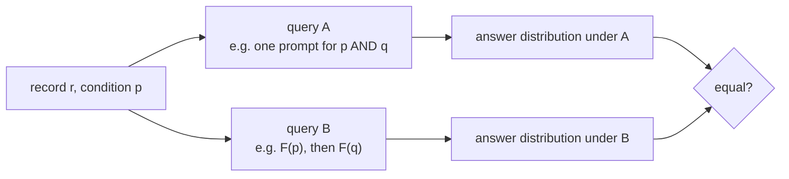

# Design

This document describes what the benchmark measures and how: the identities, the test, the benchmark's items, the
models and the analyses behind each result of the paper.

## 1. The assumption under test

A semantic operator asks an LLM about each record: a filter `F(r, p)` asks whether record `r` satisfies a condition
`p` written in natural language, a matcher `M(a, b)` asks whether two records describe the same item, a map
rewrites a value, and `COUNT_LLM` asks how many records of a batch satisfy `p`. Optimizers, caches and query
authors rewrite such queries as if each answer depended only on the record and the meaning of the condition. An
**identity** is a pair of queries A and B that must return the same answers if that assumption holds.



## 2. The identities

| | Identity | Query A | Query B | What it assumes |
|---|---|---|---|---|
| H1 | Symmetry | M(a, b) | M(b, a) | whether two records match does not depend on their order |
| H2 | Negation | F(r, p) | not F(r, not p) | asking for the opposite condition and flipping the answer gives the same records |
| H3 | Fusion | F(r, p and q) | F(r, p) and F(r, q) | one fused condition gives the same answer as its two parts asked separately |
| H4 | Batch neighbors | F(r in batch N1) | F(r in batch N2) | a record's answer does not depend on the other records in its prompt |
| H5 | Placement | F(r) | F(r joined with s) | a filter gives the same answer before and after a join |
| H6 | Idempotence | map(x) | map(map(x)) | applying a map to its own output does not change it |
| H7 | COUNT | COUNT_LLM(R) | sum of F(r, p) over R | a count equals the sum of the per-record answers |
| S3 | Conjunct order | F(r, p and q) | F(r, q and p) | the order of two conditions does not matter |
| S4₁ | Position | F(r at position j) | F(r at position j+1) | a record's position in a batch does not matter |
| S4₂ | Batching | F(r) alone | F(r in a batch) | asking about a record alone or in a batch gives the same answer |
| S5 | Renamed columns | F(r) | F(r joined with s, columns renamed) | renaming the joined columns does not matter |

H1 to H7 are the core identities and S3 to S5 extend them. In the code, position is `S2` and batching is `S4`
(`batch_position`, `batch_vs_single`); the paper calls them S4₁ and S4₂.

## 3. The test

Each query is answered k = 5 times for each item. For an item, the **excess divergence** is

    Δ = mean over all pairs (A_u, B_v) of K(A_u, B_v)  −  ½ [ mean over pairs u ≠ v of K(A_u, A_v)
                                                              + mean over pairs u ≠ v of K(B_u, B_v) ]

where K is 1 when two outputs differ and 0 otherwise (for COUNT, the squared difference of the two numbers). The
first term is how often the two queries disagree; the second is how often each query disagrees with itself. Δ is
zero in expectation when A and B are interchangeable, whatever the model's noise. Averaged over the items it is
`Δ̄`, and `√Δ̄` is the root-mean-square change in the probability of an answer (for COUNT, in records per batch
of ten).

- **Test:** a permutation test that swaps the labels A and B within items; for batched prompts, where items share a
  prompt, the larger of the permutation p-value and a cluster-robust one.
- **Intervals:** bootstrap over items, or over shared records and prompts where items share them.
- **Multiple tests:** Holm's correction within each model, separately over H1 to H7 and over S3 to S5.
- **Size:** a violation is above the smallest effect of interest when `√Δ̄ ≥ 0.05` (0.5 records for COUNT); it
  passes the minimum-effect reading when the lower bound of its 95% interval is also above it.
- **Stable violations:** items on which both queries answer the same in all five draws but differently from each
  other, compared with how many a random assignment of the draws would give; noise cannot produce many of them.

The code is in [`harness/semaudit/stats.py`](../harness/semaudit/stats.py) and
[`harness/semaudit/identities.py`](../harness/semaudit/identities.py).

## 4. The benchmark

Six datasets from four domains (details in [`DATA.md`](DATA.md)). Each has one condition pair, a condition p and a
second condition q chosen together (the A pairs: WDC-A, Abt-A, CUAD-A, ArgQ-A, arXiv-A, ArgKP-A). Every record of
a pair is asked p, not p, q, "p and q" and "q and p".

| Identity | WDC Products | Abt-Buy | CUAD | ArgQ-30k | arXiv | ArgKP |
|---|---|---|---|---|---|---|
| Symmetry | 200 record pairs | 200 | not tested | not tested | not tested | 200 |
| Negation, fusion, conjunct order, batch neighbors, position, batching, idempotence | 200 records | 200 | 200 | 200 | 200 | 200 |
| COUNT | 20 batches of 10 | 20 | 20 | 20 | 20 | 20 |
| Placement, renamed columns | 200 joined pairs | 200 | not tested | not tested | not tested | 120 |

- **Symmetry** asks about 100 matching pairs and 100 look-alike non-matches (a record and one of the most similar
  records of another item), each in both orders. Only the three matching datasets know which records match.
- **Batch identities** put 10 records in a prompt; batch neighbors and position compare the same record in two
  batches or at two positions.

  ```mermaid
  flowchart LR
      G["grid: batches of 10 records"] --> N1["N1: the grid's batches<br/>record r at position j"]
      G --> N2["N2: column j shifted<br/>same position j, nine new neighbors"]
      G --> ROT["rotation: same neighbors,<br/>every record one position later"]
      G --> ONE["each record alone"]
  ```

  Batch neighbors compares N1 with N2, position compares N1 with the rotation, and batching compares each record
  alone with N1.
- **Placement and renamed columns** join a record with its matching record (on WDC Products, two offers of the
  same product) and apply p before the join, after it, and after it with renamed columns.
- **Idempotence** applies a map that rewrites one text field into a canonical form, then applies it again, in
  two phases so that the two queries never share a draw:

  ```mermaid
  flowchart LR
      X["value x"] --> P1["phase 1: draw map(x)<br/>(the inputs)"]
      P1 --> Y["y = map(x)"]
      X --> A["query A: map(x) drawn afresh"]
      Y --> B["query B: map(y) = map(map(x))"]
  ```
- **Items** are sampled once with a fixed seed per pair, so every model answers exactly the same items
  ([`grid/build_units.py`](../grid/build_units.py) writes them to [`grid/units/`](../grid/units)).

**Rewordings.** To see whether a logical rewrite moves answers more than wording alone, five rewrites that keep the
meaning run on the same records: two paraphrases of p (a light one and a restructured one), a second prompt
template (the condition first, answered Yes or No), the record's fields in reverse order, and a paraphrase of
"p and q". They are compared with negation, fusion and conjunct order.

## 5. The models

| Model | Served by | Setting |
|---|---|---|
| Claude Haiku 5.5 | Anthropic API | thinking off |
| GPT-5.6 Luna | OpenRouter, pinned to OpenAI | reasoning off |
| Gemini 3.5 Flash-Lite | OpenRouter, pinned to Google AI Studio | lowest reasoning setting, no reasoning tokens |
| Qwen 3.7 Flash | OpenRouter, pinned to Alibaba | reasoning off |
| Gemini 3.5 Flash | OpenRouter, pinned to Google AI Studio | lowest reasoning setting, no reasoning tokens |
| Claude Sonnet 5.5 | Anthropic API | thinking off |
| GPT-5.6 Terra | OpenRouter, pinned to OpenAI | reasoning off |

Every model uses its provider's default sampling, at most 1,024 output tokens and one serving host with fallbacks
disabled. A guard stops a model if a call reports reasoning tokens or a thinking block, or comes from another model
or host ([`grid/backends.py`](../grid/backends.py)).

**Reasoning on.** Sonnet, Haiku and Luna ran every cell except the rewordings a second time with reasoning at medium
effort (adaptive thinking for the Claude models), at most 4,096 output tokens ([`grid/reason.py`](../grid/reason.py)).
The models decide per call whether to reason; a call counts as reasoned when the provider reports thinking for it.

**Reuse.** Some cells reuse calls logged in earlier runs of the same requests. A cell reuses a run only if that run
holds a successful call for every task of the cell with a byte-identical prompt, so both queries of every
comparison come from one run ([`grid/coverage.py`](../grid/coverage.py); the runs each cell reads are listed in
[`grid/coverage.json`](../grid/coverage.json) under `sources`).

## 6. The analyses

| Result in the paper | Computed by | Output in `grid/results/a-pairs/` |
|---|---|---|
| Table III, the identities pooled over datasets | `grid/analyze.py` | `grid.json`, `GRID.md` |
| Fig. 3, per identity, model and dataset, and the noise floor | `grid/analyze.py` (values), `grid/paper_numbers.py` (noise floor) | `grid.json`, `paper_numbers.json` |
| Table IV, identities against rewordings | `grid/analyze_rewording.py` | `rewording.json`, `REWORDING.md` |
| Fig. 4, records returned | `grid/paper_numbers.py` | `paper_numbers.json`, `PAPER-NUMBERS.md` |
| Table V and Section V-E, accuracy | `grid/analyze_accuracy.py`, `grid/paper_numbers.py` | `accuracy.json`, `paper_numbers.json` |
| Table VI and Section V-F, reasoning | `grid/analyze_reason.py`, `grid/paper_numbers.py` | `reason.json`, `REASON.md`, `paper_numbers.json` |
| Spread across datasets | `grid/analyze_meta.py` | `meta.json`, `meta_sqrt.json` |

**Accuracy.** Where a dataset gives the correct answer ([`DATA.md`](DATA.md)), both queries of an identity are
scored on the same items. The change in accuracy is tested per dataset with a paired, cluster-robust t-test, and
pooled over datasets by REML with a Hartung-Knapp-Sidik-Jonkman interval
([`harness/extension/accuracy.py`](../harness/extension/accuracy.py), [`harness/extension/meta.py`](../harness/extension/meta.py)).

**Records returned.** For each identity and model, the number of records each draw returns is summed over the items;
the mean absolute difference between every draw of A and every draw of B is compared with that between two draws of
one query, per 1,000 items, per dataset and then averaged with each dataset weighted by its items. Because it
compares counts, it is a lower bound on how many records change.
